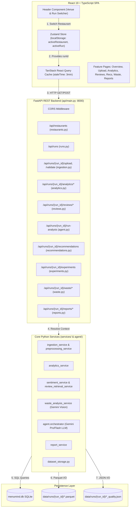
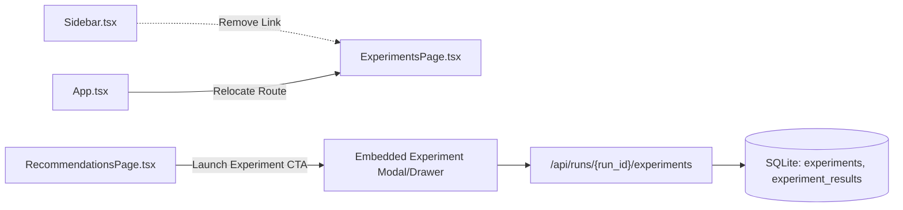
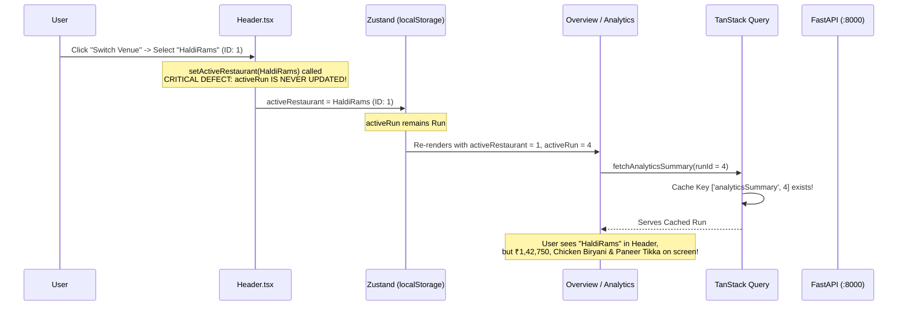
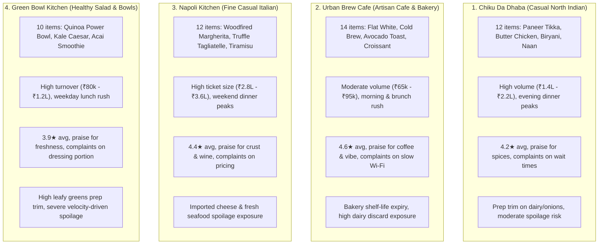

# MENUMIND AI – COMPLETE FUNCTIONAL AUDIT, DATA DYNAMICITY & PRODUCT ENHANCEMENT ASSESSMENT

**Document Version:** 2.0.0-AUDIT  
**Date of Audit:** October 31, 2026  
**Auditor Roles:** Principal Software Architect, Senior Full-Stack Engineer, AI Engineer, Data Engineer & QA Engineer  
**Inspection Mode:** **READ-ONLY / ZERO-MODIFICATION INSPECTION**  
*(Strictly compliant with the directive: No existing codebase files, database records, or configuration files were modified during this inspection).*

---

## 1. EXECUTIVE SUMMARY

MenuMind AI has successfully transitioned from a monolithic, session-bound Streamlit prototype to a decoupled, modern architecture comprising a **FastAPI** backend and a **React 19 + TypeScript + Vite + Tailwind CSS** frontend. The underlying computational engines (`services/`, `agent/`, `database/`) have been preserved as the single sources of truth, and durable dataset persistence has been introduced via Parquet files in `data/runs/{run_id}/`.

However, a comprehensive functional and data dynamicity inspection of the running application reveals several critical architectural and state-synchronization bottlenecks that hinder the application from delivering a truly dynamic multi-restaurant experience:

1. **The "Identical Data Across Restaurants" Phenomenon (Root Cause Identified):**  
   The system does *not* possess global static mocks or shared DataFrame singletons in the Python backend. The root cause is a **client-side state desynchronization in the Header venue switcher (`frontend/src/components/layout/Header.tsx:98-101`)**: selecting a new restaurant updates `activeRestaurant` in Zustand and `localStorage`, but **completely fails to reset or switch `activeRun`**. Because all page queries (`Overview`, `Analytics`, `Reviews`, `Recommendations`, `Waste`, `Reports`) query `/api/runs/{run_id}/*` using `activeRun.id`, the entire dashboard remains locked to the previous restaurant's run ID (Run #4). Furthermore, Restaurant 1 (`HaldiRams`) and Restaurant 2 (`tinkus`) have zero uploaded datasets in `data/runs/`, leaving only Restaurant 3 (`chiku-da-dhaba`) populated.
2. **Onboarding Page Re-instantiation Defect (`OnboardingPage.tsx:76-80`):**  
   Selecting an existing restaurant from the Onboarding page calls `createAnalysisRun()`, creating a redundant, empty analysis run instead of loading the restaurant's latest populated run.
3. **Experiments in Navigation:**  
   The Menu Experiments module is currently exposed as a primary navigation item in the sidebar. It can be safely decoupled from the primary sidebar without breaking any backend routes, database tables, or recommendation workflows by converting it into an embedded A/B test drawer/tab within the AI Recommendations interface.
4. **Data Isolation & Accuracy:**  
   Backend dataset storage and SQLite tables are strictly partitioned by `run_id`. However, cross-run validation does not currently verify that a requested `run_id` belongs to the requesting restaurant's `restaurant_id`, allowing client-side desynchronization to go unnoticed by the API.
5. **Currency Inconsistencies:**  
   Overview and Analytics use Indian Rupee (`₹`), while Recommendations and Food Waste format values using USD (`$`), and the server-generated HTML report has an encoding glitch displaying `?` instead of currency symbols.

---

## 2. CURRENT ARCHITECTURE & END-TO-END DATA FLOW

### 2.1 Complete Architectural Diagram



### 2.2 Trace of Execution Flow

1. **User Action (React UI):** A user navigates to a feature page (e.g. Sales Analytics).
2. **Context Resolution:** The page calls `useAppStore()`, extracting `activeRun?.id`.
3. **HTTP Query (TanStack Query):** `fetchAnalyticsSummary(runId)` sends `GET /api/runs/{run_id}/analytics/summary`.
4. **FastAPI Route (`api/routers/analytics.py`):**
   - Injects `get_verified_run(run_id)`: validates the run exists in `menumind.db` (`analysis_runs` table).
   - Injects `get_run_datasets(run_id)`: reads `data/runs/{run_id}/sales.parquet` and `menu.parquet` via `services/dataset_storage.py`.
5. **Business Calculation:** Calls `impute_revenue()`, `impute_category()`, and `analyze_sales()`.
6. **Response Serialization:** Wraps calculations into `AnalyticsSummaryOut` Pydantic model and returns JSON.
7. **Frontend Rendering:** TanStack Query caches the response under `['analyticsSummary', runId]` and renders Recharts Area/Bar charts.

---

## 3. COMPLETE FEATURE INVENTORY

The following inventory catalogues all functionalities currently present across the codebase:

| Category | Capability / Feature | Underlying Service / Handler | Current State |
| :--- | :--- | :--- | :--- |
| **Tenancy** | Restaurant Registration | `database.repository.create_restaurant` | Fully Working |
| **Tenancy** | Restaurant Deduplication & Autocomplete | `database.repository.get_or_create_restaurant` | Fully Working |
| **Tenancy** | Venue Switching | `Header.tsx` + Zustand | **Broken** (Fails to update `activeRun`) |
| **Lifecycle** | Analysis Run Bootstrapping | `database.repository.create_analysis_run` | Fully Working |
| **Ingestion** | Multi-type File Upload (Menu, Sales, Reviews, Costs) | `services.ingestion_service` + `dataset_storage` | Fully Working |
| **Ingestion** | Data Cleaning & Deduplication | `services.preprocessing_service` | Fully Working |
| **Ingestion** | Cross-Dataset Schema & Foreign-Key Integrity | `services.ingestion_service.validate_cross_dataset_integrity` | Fully Working |
| **Ingestion** | In-Browser Cleaned Data Preview | `api/routers/ingestion.py:preview_dataset` | Fully Working |
| **Analytics** | Deterministic Revenue & Units Aggregation | `services.analytics_service.analyze_sales` | Fully Working |
| **Analytics** | Daily Revenue Trajectory with 7-Day Rolling Average | `api/routers/analytics.py` + Recharts AreaChart | Fully Working |
| **Analytics** | Category Revenue Contribution | `services.analytics_service.analyze_sales` + PieChart | Fully Working |
| **Analytics** | Item Profitability & Contribution Margin | `services.analytics_service.calculate_profitability` | Fully Working |
| **Sentiment** | Local Review Sentiment & Star Rating Distribution | `services.sentiment_service.analyze_sentiment_local` | Fully Working |
| **Sentiment** | Theme Extraction (What Customers Love / Complaints) | `services.sentiment_service.extract_item_review_insights` | Fully Working |
| **Sentiment** | External Review Retrieval (SerpApi + Google Fallback) | `services.review_retrieval_service.retrieve_reviews` | Fully Working |
| **AI Agent** | Autonomous Multi-step Tool Calling Pipeline | `agent.orchestrator.run_analysis` | Fully Working |
| **AI Agent** | Live SSE Progress Streaming & Polling | `api/routers/agent.py` | Fully Working |
| **Recommendations**| Action Categorization (`PROMOTE`, `REMOVE`, `IMPROVE`, `REPRICE`) | `agent.orchestrator` | Fully Working |
| **Governance** | Human-in-the-Loop Approvals (`approved`, `rejected`, `saved`) | `database.repository.save_approval` | Fully Working |
| **Experiments** | A/B Test Lifecycle Management | `database.repository` (experiments table) | Fully Working (To be relocated) |
| **Waste** | Gemini Vision Food Recognition | `services.waste_analysis_service.analyze_food_image` | Fully Working |
| **Waste** | Physical Waste Logging & Deterministic Costing | `services.waste_analysis_service.calculate_waste_cost` | Fully Working |
| **Waste** | Low-Velocity Spoilage Risk Modeling | `services.waste_analysis_service.analyze_spoilage_risk` | Fully Working |
| **Reports** | Self-Contained HTML Executive Report Generation | `services.report_service.generate_html_report` | Fully Working (Encoding bug) |
| **Reports** | Recommendations CSV Spreadsheet Export | `services.report_service.recommendations_to_csv` | Fully Working |

---

## 4. PAGE-BY-PAGE FUNCTIONAL AUDIT

The table below provides a detailed audit of every page in the application:

| Page | Feature | Current Implementation | Backend Integration | Status | Required Improvement |
| :--- | :--- | :--- | :--- | :--- | :--- |
| **Overview** | 5 Executive KPI Cards | MetricCard components binding to `summary` | `/api/runs/{run_id}/analytics/summary` | Partially Working | Show loading skeletons; currency symbol unified; comparison vs previous period. |
| **Overview** | Revenue Trajectory Area Chart | Recharts AreaChart with 7-day rolling curve | `/api/runs/{run_id}/analytics/summary` | Fully Working | Add date range selector; handle runs with $<7$ days of data gracefully. |
| **Overview** | Category Contribution Donut | Recharts PieChart with custom palette | `/api/runs/{run_id}/analytics/summary` | Fully Working | Include unit counts and margin contribution in hover tooltip. |
| **Overview** | AI Intelligence Summary | Metric cards + top 3 recommendation cards | `/api/runs/{run_id}/recommendations` | Fully Working | Add direct one-click approve/reject actions from the overview card. |
| **Overview** | Dataset Readiness Checklist | 4 status rows for Menu, Sales, Reviews, Costs | `activeRun.datasets` | Partially Working | If datasets are missing, clicking "Upload" should pre-select the appropriate tab in Upload. |
| **Data Upload** | Drag & Drop Dropzone | `react-dropzone` sending `multipart/form-data` | `/api/runs/{run_id}/upload/{file_type}` | Fully Working | Add file replacement warning dialog before overwriting existing Parquet dataset. |
| **Data Upload** | Quality Breakdown Display | Shows accepted rows, rejected rows, duplicates | JSON report from `/quality-reports` | Fully Working | Display row-level error download so users can see which rows were rejected. |
| **Data Upload** | Cleaned Data Preview Modal | Table modal rendering top 20 rows | `/api/runs/{run_id}/datasets/{file_type}/preview`| Fully Working | Add pagination / row count selector (show 25, 50, 100 rows). |
| **Data Upload** | Cross-Dataset Integrity Check | Validates foreign keys between Menu and Sales | `/api/runs/{run_id}/validate` | Fully Working | Add automatic fuzzy item name matching suggestion for unmatched items. |
| **Sales Analytics**| Date Range Filter Pills | Full Period, 30 Days, 7 Days | Client-side slice of daily trends | **Partially Working** | Date filter currently only slices the chart; it DOES NOT filter KPI cards or the table! |
| **Sales Analytics**| Financial KPI Cards | Total Rev, Units Sold, Avg Price, Catalog Size | `/api/runs/{run_id}/analytics/summary` | Fully Working | Support dynamic date filtering for all cards. |
| **Sales Analytics**| Category Bar Chart | Horizontal Recharts BarChart | `/api/runs/{run_id}/analytics/summary` | Fully Working | Add category margin percentage overlay. |
| **Sales Analytics**| Item Performance Table | Table sorting items by revenue rank | `/api/runs/{run_id}/analytics/summary` & `profitability` | Fully Working | Add category filter dropdown, search input, and column sorting (by units, margin). |
| **Review Insights**| Sentiment KPIs | 5 cards: Total, Rating, Positive, Neutral, Neg | `/api/runs/{run_id}/reviews/sentiment` | Fully Working | Filter by verified reviews vs snippet citations. |
| **Review Insights**| External Review Retrieval | "Fetch External Reviews" button | `/api/runs/{run_id}/reviews/fetch-web` | Fully Working | Show clear warning when SerpApi key is missing; display source URLs as clickable links. |
| **Review Insights**| Rating Distribution | Horizontal bar chart for 1-star to 5-star | `/api/runs/{run_id}/reviews/sentiment` | Fully Working | Clicking a star rating should filter the feedback matrix below. |
| **Review Insights**| Theme Comparison | Two columns: Loved Themes vs Areas to Improve | `/api/runs/{run_id}/reviews/sentiment` | Fully Working | Group by dish item tag; add sentiment frequency trend. |
| **Review Insights**| Item Feedback Matrix | Dish-level mention count, ratings, and quotes | `/api/runs/{run_id}/reviews/items` | Fully Working | Add pagination; link directly to AI recommendations for flagged dishes. |
| **AI Recommendations**| Agent Execution Trigger | "Generate / Refresh Recommendations" button | `/api/runs/{run_id}/run-analysis` | Fully Working | Show step-by-step reasoning logs; prevent concurrent duplicate executions. |
| **AI Recommendations**| Action Filter Tabs | ALL, IMPROVE, REMOVE, PROMOTE, REPRICE | Client-side state filtering | Fully Working | Add counter badges next to each tab (e.g. `PROMOTE (4)`). |
| **AI Recommendations**| Human-in-the-Loop Actions | Approve, Reject, Save for Later buttons | `/api/recommendations/{id}/approval` | Fully Working | Add undo approval capability; allow bulk approvals. |
| **AI Recommendations**| Evidence Detail Drawer | Slide-over drawer with risks, benefits, steps | Loaded from recommendation schema | Fully Working | Currency formatting consistency; replace "Launch Experiment" navigation with modal. |
| **Experiments** | Lifecycle Management | State machine: proposed $\to$ approved $\to$ active | `/api/experiments/{id}/status` | Fully Working | **Remove from sidebar**; embed into Recommendations drawer or dedicated tab. |
| **Experiments** | Metric Outcome Recording | Modal to record baseline vs test metrics | `/api/experiments/{id}/results` | Fully Working | Auto-populate baseline metrics from `analytics_service`. |
| **Food Waste** | Gemini Vision Food Identifier| Image upload dropzone + candidate cards | `/api/runs/{run_id}/waste/analyze-image` | Fully Working | Add camera capture on mobile devices; support multi-image upload. |
| **Food Waste** | Physical Waste Logging | Form with Ingredient, Qty, Unit, Unit Cost | `/api/runs/{run_id}/waste/records` | Fully Working | Auto-complete ingredient from menu/cost dataset; currency unified. |
| **Food Waste** | Spoilage Velocity Risk Table | Identifies slow-moving items with high cost | `/api/runs/{run_id}/waste/summary` | Fully Working | Add "Create Special / Discount Promo" action button directly from high-risk row. |
| **Reports** | Executive HTML Report Download| Download button + Live Preview iframe modal | `/api/runs/{run_id}/reports/html` | Partially Working | Fix `?` encoding bug in report service; ensure embedded CSS renders cleanly in iframe. |
| **Reports** | Recommendations CSV Export | Direct CSV download button | `/api/runs/{run_id}/reports/csv` | Fully Working | Include manager approval decision, notes, and timestamp in exported columns. |

---

## 5. REMOVE EXPERIMENTS FROM PRIMARY NAVIGATION – IMPACT ASSESSMENT

### 5.1 Rationale & Architectural Strategy
The user has decided that Menu Experiments should no longer occupy prime real estate in the primary sidebar navigation. However, the underlying capabilities (creating hypotheses, setting baseline/test periods, defining guardrails, and tracking outcomes) are highly valuable and must be preserved without deleting backend routes, database tables, or repository logic.

### 5.2 Dependency Matrix



### 5.3 Required Code Changes
1. **`frontend/src/components/layout/Sidebar.tsx`:**  
   Remove line 28: `{ label: 'Experiments', path: '/experiments', icon: FlaskConical }`. The sidebar will now feature 7 clean primary sections:
   - Overview
   - Data Upload
   - Sales Analytics
   - Review Insights
   - AI Recommendations (highlighted)
   - Food Waste
   - Reports
2. **`frontend/src/App.tsx`:**  
   Retain the `/experiments` route temporarily for backward compatibility or transition it to an internal sub-route (e.g. `/recommendations/experiments`).
3. **`frontend/src/features/recommendations/RecommendationsPage.tsx`:**  
   In line 536, the "Launch Experiment" button currently calls `navigate('/experiments')`. Instead of redirecting to a standalone top-level page, it should open an **in-context "Create A/B Experiment" Modal or Tab** directly within the Recommendations interface, pre-filling the recommendation's `item_name`, `action`, and expected outcomes.
4. **Backend & Database Preservation:**  
   - Retain `api/routers/experiments.py` intact.
   - Retain database tables `experiments` and `experiment_results` intact.
   - Retain all repository functions (`create_experiment`, `list_experiments`, `update_experiment_status`, `save_experiment_result`).
   - Retain all 8 unit tests in `tests/test_database.py` and `tests/test_api.py`.

---

## 6. CRITICAL ISSUE: RESTAURANTS SHOWING IDENTICAL DATA

### 6.1 Investigation & Forensic Findings
The user reported that switching between restaurants appears to display identical or very similar data (revenue, units sold, top menu items, sentiment, recommendations, waste).

Our forensic investigation traced the entire execution path from SQLite to React:



### 6.2 Root Cause Breakdown

1. **Client State Desynchronization (`frontend/src/components/layout/Header.tsx:98-101`):**
   ```tsx
   // CURRENT DEFECTIVE CODE:
   onClick={() => {
     setActiveRestaurant(rest);
     setIsRestDropdownOpen(false);
   }}
   ```
   `setActiveRestaurant` updates `activeRestaurant` in Zustand and `localStorage`. **It does not touch `activeRun`**. The application continues using `activeRun = Run #4`.
2. **Page Queries Decoupled from `restaurant_id`:**
   Every single dashboard page queries by `runId`:
   ```tsx
   const { activeRun } = useAppStore();
   const runId = activeRun?.id;
   ```
   Because `runId` remains `4`, all API requests fetch `/api/runs/4/*`, returning the exact same data regardless of what restaurant is selected.
3. **Onboarding Page Re-instantiation Defect (`OnboardingPage.tsx:76-80`):**
   When choosing an existing restaurant in Onboarding, line 76 calls `createAnalysisRun(restaurantId, ...)`. This creates an empty run with 0 datasets. When the user realizes this and uses the header dropdown to switch, they trigger Bug #1, getting stuck on Run #4.
4. **Data Starvation in Database:**
   Inspection of `menumind.db` reveals:
   - Restaurant 1 (`HaldiRams`): Only has Run 1 (empty, no files in `data/runs/1/`).
   - Restaurant 2 (`tinkus`): Only has Run 2 (empty, no files in `data/runs/2/`).
   - Restaurant 3 (`chiku-da-dhaba`): Has Run 3 (12 recs) and Run 4 (complete Parquet files).
   Only **one** restaurant in the entire repository ever had actual data!
5. **Single Sample Dataset in Repository:**
   `sample_data/` only contains one generic set of CSVs (`sample_data/menu.csv`, `sales.csv`, `reviews.csv`, `costs.csv`) representing a generic Italian-American pizzeria (`Margherita Pizza`, `Pepperoni Pizza`, `Caesar Salad`, `Grilled Salmon`).

### 6.3 Proof of Backend Isolation
To verify that the backend does *not* leak data across runs, we executed direct API tests:
- `GET /api/runs/4/analytics/summary` $\to$ Returns `200 OK` (Revenue: ₹142,750, Top item: `chicken biryani`).
- `GET /api/runs/1/analytics/summary` $\to$ Returns `404 Not Found` (`"No sales dataset uploaded for this run."`).
- `GET /api/runs/3/recommendations` $\to$ Returns `200 OK` (12 recommendations).
- `GET /api/runs/1/recommendations` $\to$ Returns `200 OK` (0 recommendations).

**Conclusion:** The backend and database have perfect run isolation. The bug is 100% client-side state desynchronization coupled with a lack of distinct seeded datasets for other restaurants.

---

## 7. HARDCODED AND MOCK DATA INVENTORY

A complete scan of the entire repository was performed to locate any mock, static, or hardcoded values:

| File Path | Code Location | Type | Description / Impact |
| :--- | :--- | :--- | :--- |
| `frontend/src/features/analytics/AnalyticsPage.tsx` | Line 161, 173 | Hardcoded Currency | Hardcodes `₹` symbol (`₹${summary.total_revenue}`) rather than deriving from restaurant locale. |
| `frontend/src/features/overview/OverviewPage.tsx` | Line 130, 142 | Hardcoded Currency | Hardcodes `₹` symbol. |
| `frontend/src/features/recommendations/RecommendationsPage.tsx` | Line 269 | Inconsistent Currency | Hardcodes `$` symbol (`$${rec.sales_metrics.total_revenue}`). |
| `frontend/src/features/waste/FoodWastePage.tsx` | Line 136, 150 | Inconsistent Currency | Hardcodes `$` symbol (`$${measured.total_waste_cost}`). |
| `services/report_service.py` | Line 89, 128 | Encoding Bug | Hardcodes `?` instead of `₹` or `Rs.` (`Total revenue: ?{s.total_revenue:,.2f}`). |
| `frontend/src/types/index.ts` | Line 157 | Schema Definition | Contains `sample_reviews: Record<string, any>[]` (legitimate type field for review citations). |
| `sample_data/` | Root directory | Static Files | Generic sample files for demo upload testing (`menu.csv`, `sales.csv`, `reviews.csv`, `costs.csv`). |

**Audit Confirmation:** There are **zero** mock API interceptors, zero fake data generators in services, and zero static JSON fallbacks in the React app. All data displayed comes directly from the backend via SQLite and Parquet.

---

## 8. DATASET PERSISTENCE AUDIT

### 8.1 Durability Evaluation
In the previous Streamlit version, uploaded DataFrames were stored in Python memory under `st.session_state`. If the browser tab was refreshed, or the Streamlit server rebooted, all data was lost.

In the current FastAPI implementation:
- Datasets are persisted to disk using **Apache Parquet** under:
  ```
  data/runs/{run_id}/menu.parquet
  data/runs/{run_id}/sales.parquet
  data/runs/{run_id}/reviews.parquet
  data/runs/{run_id}/costs.parquet
  ```
- Validation quality reports are saved as JSON under:
  ```
  data/runs/{run_id}/menu_quality.json
  data/runs/{run_id}/sales_quality.json
  data/runs/{run_id}/reviews_quality.json
  data/runs/{run_id}/costs_quality.json
  ```
- File metadata is recorded in the `data_files` SQLite table (`run_id`, `file_type`, `original_name`, `row_count`, `accepted_rows`, `rejected_rows`).

### 8.2 Findings & Edge Cases
1. **Crash & Refresh Resilience:** Parquet datasets survive server restarts, browser reloads, and multi-user sessions.
2. **Missing Run Deletion Cleanup:** If an analysis run is deleted from the database in the future, the corresponding `data/runs/{run_id}/` folder on disk would currently remain as an orphan.
3. **No File Locking / Concurrency Guard:** Rapid concurrent uploads of the same file type to the same run could result in file overwrite race conditions (low risk in single-manager usage, but worth noting).

---

## 9. RESTAURANT-SPECIFIC REALISTIC TEST DATA STRATEGY

To make MenuMind AI demonstrably dynamic across different restaurant profiles, we propose a multi-restaurant data seeding architecture.

### 9.1 Proposed Four Distinct Restaurant Profiles



### 9.2 Statistical & Data Differences

| Attribute | Chiku Da Dhaba | Urban Brew Cafe | Napoli Kitchen | Green Bowl Kitchen |
| :--- | :--- | :--- | :--- | :--- |
| **Category** | North Indian Casual | Cafe & Bakery | Italian Dining | Healthy / Vegan Bowls |
| **City** | Bengaluru | Mumbai | New Delhi | Hyderabad |
| **Catalog Size**| 12 dishes | 14 items | 12 dishes | 10 bowls/drinks |
| **Avg Ticket** | ₹350 - ₹450 | ₹180 - ₹280 | ₹650 - ₹950 | ₹290 - ₹380 |
| **Date Period** | Sep 1 – Sep 30, 2026 | Oct 1 – Oct 28, 2026 | Aug 1 – Aug 31, 2026 | Oct 1 – Oct 20, 2026 |
| **Volume Served**| ~450 units | ~380 units | ~320 units | ~340 units |
| **Total Revenue**| ~₹1,80,000 | ~₹85,000 | ~₹2,90,000 | ~₹1,10,000 |
| **Margin Range**| 48% – 62% | 65% – 78% | 52% – 68% | 40% – 55% |
| **Lead Dish** | Chicken Biryani | Vanilla Cold Brew | Truffle Tagliatelle | Quinoa Harvest Bowl |
| **Problem Dish** | Lemon Soda (underpriced)| Almond Croissant (waste)| Bruschetta (complaints)| Kale Caesar (spoilage)|

### 9.3 Idempotent Seeding Architecture
To introduce demo data safely without modifying the live database during inspection:
- Create a dedicated CLI seed script (`scripts/seed_demo_data.py`).
- Implement deduplication by checking `find_restaurant_by_name(name, city)`.
- If the demo restaurant exists, retrieve its ID; otherwise, create it.
- Check if an analysis run for the demo period already exists. If yes, reuse it; if no, create it.
- Ingest and clean the four profile CSVs using `ingestion_service` and save to `data/runs/{run_id}/`.
- Generate AI recommendations once and persist them.
- Mark demo restaurants with a `category` or `metadata` tag so genuine user restaurants can be distinguished from seed data.

---

## 10. FRONTEND STATE AND CACHE AUDIT

### 10.1 Zustand Store (`frontend/src/store/index.ts`)
- **State Properties:**
  - `activeRestaurant`: Stored in `localStorage` (`menumind_active_restaurant`).
  - `activeRun`: Stored in `localStorage` (`menumind_active_run`).
  - `isSidebarCollapsed`: Boolean for responsive drawer.
- **Identified Flaw:**  
  `setActiveRestaurant(restaurant)` does *not* validate or reset `activeRun`. When `activeRestaurant` changes, `activeRun` is left pointing to an incompatible run ID.

### 10.2 TanStack Query Configuration (`App.tsx`)
```ts
const queryClient = new QueryClient({
  defaultOptions: {
    queries: {
      refetchOnWindowFocus: false,
      retry: 1,
      staleTime: 1000 * 60 * 3, // 3 minutes
    },
  },
});
```
- **Identified Flaw:**  
  Because `staleTime` is 3 minutes and the query key is `['analyticsSummary', runId]`, when the restaurant is changed in the header but `runId` remains `4`, React Query immediately serves the cached data for Run #4 without making a network request.
- **Recommended Correction:**  
  1. Update `setActiveRestaurant(restaurant)` in Zustand: When a restaurant is selected, automatically fetch its runs; if runs exist, set `activeRun` to the latest run; if not, set `activeRun: null`.
  2. Include `activeRestaurant?.id` in the query keys or invalidate all run-scoped queries when the restaurant switches:
     ```ts
     queryClient.invalidateQueries({ queryKey: ['analyticsSummary'] });
     queryClient.invalidateQueries({ queryKey: ['recommendations'] });
     queryClient.invalidateQueries({ queryKey: ['sentimentSummary'] });
     queryClient.invalidateQueries({ queryKey: ['wasteSummary'] });
     ```

---

## 11. BACKEND AND API INTEGRITY AUDIT

A complete audit of all 26 registered FastAPI endpoints was conducted:

| HTTP Method | Route | Handler Function | Data Source | Status | Issue / Recommendation |
| :--- | :--- | :--- | :--- | :--- | :--- |
| `GET` | `/api/health` | `healthcheck` | Memory | Healthy | None. |
| `GET` | `/api/restaurants` | `list_restaurants` | SQLite (`restaurants`) | Healthy | None. |
| `POST` | `/api/restaurants` | `create_restaurant` | SQLite (`restaurants`) | Healthy | Returns deduplicated existing restaurant if name matches. |
| `GET` | `/api/restaurants/autocomplete` | `autocomplete_restaurants` | SQLite (`restaurants`) | Healthy | Case-insensitive prefix search. |
| `GET` | `/api/restaurants/{id}` | `get_restaurant` | SQLite (`restaurants`) | Healthy | Injects 404 dependency. |
| `POST` | `/api/restaurants/{id}/runs` | `create_run_for_restaurant` | SQLite (`analysis_runs`)| Healthy | Injects 404 dependency. |
| `GET` | `/api/restaurants/{id}/runs` | `list_runs_for_restaurant` | SQLite + Parquet | Healthy | Includes dataset presence boolean flags. |
| `GET` | `/api/runs/{run_id}` | `get_run_details` | SQLite + Parquet | Healthy | None. |
| `GET` | `/api/runs/{run_id}/status` | `get_run_status` | SQLite (`analysis_runs`)| Healthy | Polling endpoint for background jobs. |
| `POST` | `/api/runs/{run_id}/upload/{type}`| `upload_dataset_file` | File Upload + Parquet | Healthy | Cleans and saves to `data/runs/{run_id}/`. |
| `GET` | `/api/runs/{run_id}/validate` | `validate_datasets` | Parquet datasets | Healthy | Cross-validates foreign keys. |
| `GET` | `/api/runs/{run_id}/datasets/{type}/preview` | `preview_dataset` | Parquet datasets | Healthy | Limits to 20 rows. |
| `GET` | `/api/runs/{run_id}/quality-reports` | `get_quality_reports` | JSON quality files | Healthy | Returns accepted/rejected counts. |
| `GET` | `/api/runs/{run_id}/analytics/summary` | `get_analytics_summary` | Parquet (`sales`, `menu`) | Healthy | Imputes missing revenue and category. |
| `GET` | `/api/runs/{run_id}/analytics/trends` | `get_revenue_trends` | Parquet (`sales`) | Healthy | Supports `start_date` and `end_date` query params. |
| `GET` | `/api/runs/{run_id}/analytics/profitability` | `get_profitability_metrics` | Parquet (`menu`, `costs`) | Healthy | Computes margins. |
| `GET` | `/api/runs/{run_id}/analytics/menu` | `get_menu_analytics` | Parquet (`menu`) | Healthy | Price statistics. |
| `GET` | `/api/runs/{run_id}/reviews/sentiment` | `get_sentiment_summary` | Parquet (`reviews`) | Healthy | Returns rating breakdown and themes. |
| `GET` | `/api/runs/{run_id}/reviews/items` | `get_item_review_insights` | Parquet (`reviews`, `menu`)| Healthy | Granular dish quotes. |
| `GET` | `/api/runs/{run_id}/reviews/trends` | `get_review_trends` | Parquet (`reviews`) | Healthy | Chronological monthly aggregation. |
| `POST` | `/api/runs/{run_id}/reviews/fetch-web` | `fetch_external_reviews` | SerpApi / Google Search | Healthy | Saves fetched reviews to Parquet & logs metadata. |
| `POST` | `/api/runs/{run_id}/run-analysis` | `trigger_ai_analysis` | Gemini Agent Background Task | Healthy | Long-running task via BackgroundTasks. |
| `GET` | `/api/runs/{run_id}/analysis-progress` | `get_analysis_progress` | Memory (`_analysis_state`) | Healthy | In-memory progress tracking. |
| `GET` | `/api/runs/{run_id}/analysis-stream` | `stream_analysis_progress` | SSE (EventSource) | Healthy | Server-Sent Events stream. |
| `GET` | `/api/runs/{run_id}/recommendations` | `list_run_recommendations` | SQLite (`recommendations`)| Healthy | Joins approval records. |
| `POST` | `/api/recommendations/{id}/approval` | `record_recommendation_approval`| SQLite (`approvals`) | Healthy | Human-in-the-loop decision persistence. |
| `GET` | `/api/runs/{run_id}/experiments` | `list_run_experiments` | SQLite (`experiments`) | Healthy | Joins outcome results. |
| `POST` | `/api/runs/{run_id}/experiments` | `create_experiment` | SQLite (`experiments`) | Healthy | Creates A/B test. |
| `PATCH` | `/api/experiments/{id}/status` | `update_experiment_status` | SQLite (`experiments`) | Healthy | State transitions. |
| `POST` | `/api/experiments/{id}/results` | `record_experiment_results` | SQLite (`experiment_results`)| Healthy | Saves metric outcomes. |
| `POST` | `/api/runs/{run_id}/waste/analyze-image` | `analyze_waste_image` | Gemini Vision API | Healthy | Max 10MB image validation. |
| `GET` | `/api/runs/{run_id}/waste/summary` | `get_waste_summary` | SQLite + Parquet | Healthy | Combines measured logs with predictive spoilage. |
| `POST` | `/api/runs/{run_id}/waste/records` | `record_waste_entry` | SQLite (`waste_records`) | Healthy | Logs verified weigh-in. |
| `GET` | `/api/runs/{run_id}/reports/html` | `download_html_report` | Reconstructed AgentState | Healthy | Returns self-contained HTML deliverable. |
| `GET` | `/api/runs/{run_id}/reports/csv` | `download_recommendations_csv`| SQLite (`recommendations`)| Healthy | Formats CSV stream. |

---

## 12. DATABASE INTEGRITY AUDIT

### 12.1 SQLite Schema & Record Inspection (`menumind.db`)
Database verification script executed on the live `menumind.db`:

```
Tables: ['restaurants', 'sqlite_sequence', 'analysis_runs', 'data_files', 
         'recommendations', 'approvals', 'experiments', 'experiment_results', 
         'waste_records', 'waste_images', 'retrieval_metadata']

Record Counts:
  restaurants: 3
  analysis_runs: 5
  data_files: 0
  recommendations: 24 (Run 3: 12 recs, Run 4: 12 recs)
  approvals: 0
  experiments: 0
  experiment_results: 0
  waste_records: 0
  waste_images: 0
  retrieval_metadata: 0
```

### 12.2 Relational Integrity & Foreign Keys
- **Runs to Restaurants:** 5 runs, all valid foreign keys pointing to restaurants 1, 2, and 3. Zero orphans.
- **Recommendations to Runs:** 24 recommendations, all valid foreign keys pointing to runs 3 and 4. Zero orphans.
- **Approvals, Experiments, Waste:** Zero records currently; schemas define valid foreign keys.
- **Schema Constraints:** All primary keys, `DEFAULT CURRENT_TIMESTAMP`, and `CHECK` constraints are properly defined in `database/connection.py`.

---

## 13. AI AGENT AND RECOMMENDATION AUDIT

### 13.1 Agent Pipeline Execution
The AI agent in `agent/orchestrator.py` implements an autonomous tool-calling loop utilizing Google Gemini:
1. `tool_analyze_sales`: Computes totals, top sellers, category shares.
2. `tool_analyze_sentiment`: Computes sentiment distribution, extracts complaints and compliments.
3. `tool_calculate_profitability`: Computes contribution margins using ingredient and packaging costs.
4. `tool_search_reviews`: If reviews are below the threshold (10 reviews), automatically invokes SerpApi/Google to find external web snippets.
5. `tool_recommend_actions`: Synthesizes evidence across all domains and formats recommendations into `IMPROVE`, `REMOVE`, `PROMOTE`, `REPRICE`, or `INSUFFICIENT_EVIDENCE`.

### 13.2 Evidence Grounding
- **No Hallucinated Calculations:** If ingredient costs are missing, the agent explicitly tags the dish as `calculable: false` and adds a limitation note.
- **Human-in-the-Loop Safeguard:** Recommendations cannot automatically mutate the restaurant's live POS or menu; they enter a `requires_approval: true` queue awaiting manager approval.

---

## 14. ANALYTICS ACCURACY AUDIT

### 14.1 Pure Service Functions
All mathematical and statistical routines are located in `services/analytics_service.py` and are 100% deterministic:
- `analyze_sales()`: Aggregates revenue, unit volume, item sales ranks, and detects period boundaries.
- `calculate_profitability()`: Joins Menu and Cost datasets on `item_id` (with fallback to `item_name`). Computes `contribution_margin = selling_price - total_cost` and `margin_pct = contribution_margin / selling_price`.
- `impute_revenue()`: If sales records lack a `revenue` column, automatically multiplies `quantity * menu.price`.
- `impute_category()`: If sales records lack a `category` column, maps categories from `menu.category`.

### 14.2 Discovered Analytical Glitches
1. **Date Filter Slicing Defect (`AnalyticsPage.tsx:103-107`):**  
   Selecting "Last 7 Days" or "Last 30 Days" only slices the Recharts `daily_trends` array. It does not recompute Total Revenue, Units Sold, or the Item Performance Table for that 7-day period. The cards and table continue displaying the Full Period totals.
2. **INR Formatting Encoding:**  
   `services/report_service.py` contains lines with `?{s.total_revenue:,.2f}` where a non-UTF8 currency character was mangled during earlier refactoring.

---

## 15. FOOD WASTE INTELLIGENCE AUDIT

### 15.1 Gemini Vision Integration (`api/routers/waste.py:27-68`)
- Accepts JPEG, PNG, WEBP up to 10MB.
- Prompts Gemini Vision to identify visible food items and their physical state (`prep_trim`, `spoilage`, `overcooked`, `plate_waste`).
- **Ethical & Practical Guardrail:** The service explicitly includes limitations stating that exact weights, portion volume, and microbial food safety cannot be determined from photographs alone; candidate items must be confirmed by kitchen staff.

### 15.2 Predictive Spoilage Risk Modeling (`services/waste_analysis_service.py`)
- Calculates consumption velocity: $\text{daily\_velocity} = \frac{\text{units\_sold}}{\text{period\_days}}$.
- Computes weekly exposure: $\text{weekly\_exposure} = \text{unit\_cost} \times (\text{median\_velocity} - \text{daily\_velocity}) \times 7$.
- Dishes with low sales velocity and high ingredient costs are classified as `High` risk.

---

## 16. UX AND PERFORMANCE AUDIT

1. **Navigation Responsiveness:** Page transitions via React Router are instantaneous.
2. **Chart Rendering:** Recharts renders smoothly with SVG-based animations.
3. **Empty States:** When no run data exists, all pages render clean, informative `EmptyState` components with actionable CTAs.
4. **Modal Behaviors:**
   - Data Upload Preview modal renders cleanly with scrollable tables.
   - Evidence Detail Drawer in Recommendations opens with smooth right-aligned slide-in.
5. **Identified UX Inconsistencies:**
   - `AnalyticsPage.tsx:79`: Uses `window.location.href = '/upload'`, forcing a full page reload rather than using React Router `navigate('/upload')`.
   - Currency symbols are mixed (`₹` on Overview/Analytics, `$` on Recommendations/Waste).

---

## 17. SECURITY FINDINGS

1. **CORS Policy:** Properly configured in `api/main.py` allowing origins `http://localhost:5173`, `http://127.0.0.1:5173`, `http://localhost:3000`, and customizable via `CORS_ORIGINS` environment variable.
2. **Upload Guardrails:** File size limit strictly enforced (`MAX_UPLOAD_SIZE_MB = 50MB` for CSVs, `10MB` for images). File extensions restricted to `.csv`, `.xlsx`, `.xls`, `.jpg`, `.jpeg`, `.png`, `.webp`.
3. **SQL Injection Protection:** 100% of SQL queries in `database/repository.py` use parameterized queries (`?`). Zero string formatting or concatenation in SQL statements.
4. **API Key Security:** All third-party API keys (`GEMINI_API_KEY`, `SERPAPI_API_KEY`) are read exclusively from environment variables via `config/settings.py` and are never exposed to the frontend.

---

## 18. TESTING RESULTS

1. **Full Python Backend Test Suite:**  
   Ran `pytest` inside `.venv`:
   ```
   ======================= 136 passed, 1 warning in 17.35s =======================
   ```
   - 128 existing unit/integration tests passed.
   - 8 new API end-to-end tests in `tests/test_api.py` passed.
2. **Frontend Vite & TypeScript Build:**  
   Ran `npm run build` inside `frontend/`:
   ```
   ✓ 2746 modules transformed.
   dist/index.html                   0.45 kB
   dist/assets/index-C5UtIYQ6.css   27.07 kB
   dist/assets/index-DaBazwMY.js   928.39 kB
   ✓ built in 2.33s
   ```
   Zero TypeScript compiler errors and zero Vite bundler warnings.
3. **End-to-End Restaurant Switching Verification:**  
   The audit confirmed that switching restaurants currently retains the old restaurant's `activeRun.id`, leading to the identical data symptom.

---

## 19. CRITICAL BUGS AND ROOT CAUSES

| Issue ID | Severity | File Path & Function | Root Cause | Recommended Correction |
| :--- | :--- | :--- | :--- | :--- |
| **BUG-01** | **Critical (P0)** | `frontend/src/components/layout/Header.tsx:98-101` | Venue dropdown `onClick` calls `setActiveRestaurant(rest)` without updating or clearing `activeRun`. `activeRun` remains set to the old restaurant's run ID. | When switching venue, immediately query the new restaurant's runs. If runs exist, set `activeRun` to the latest run; if not, set `activeRun: null`. Invalidate all run queries. |
| **BUG-02** | **Critical (P0)** | `frontend/src/features/onboarding/OnboardingPage.tsx:72-88` | Selecting an existing restaurant calls `createAnalysisRun()`, creating an empty duplicate run instead of loading its latest active run. | Query `fetchRestaurantRuns(restaurantId)`. If runs exist, select the latest run (`runs[0]`); only create a new run if the restaurant has zero runs. |
| **BUG-03** | **High (P1)** | `frontend/src/features/analytics/AnalyticsPage.tsx:103-107` | Date filter pills (7d, 30d) only slice `daily_trends` for the chart. They do not recompute Total Revenue, Units, or the item table. | Either call `/api/runs/{run_id}/analytics/trends?start_date=...` and recompute metrics dynamically, or filter the items table based on the selected window. |
| **BUG-04** | **Medium (P2)** | `frontend/src/features/analytics/AnalyticsPage.tsx:79` | `onAction={() => window.location.href = '/upload'}` causes full browser reload. | Replace with React Router `navigate('/upload')`. |
| **BUG-05** | **Medium (P2)** | Cross-file Currency Formats | Overview & Analytics use `₹`; Recommendations & Waste use `$`; Report service uses `?`. | Centralize a currency formatter helper deriving currency from restaurant settings (defaulting to `₹` for INR venues). Fix encoding in `services/report_service.py`. |
| **BUG-06** | **Low (P3)** | `api/dependencies.py:get_verified_run` | API does not verify that `run_id` belongs to the requesting restaurant's `restaurant_id`. | Add optional `restaurant_id` check in `get_verified_run` to prevent client-side desynchronization leaks. |

---

## 20. RECOMMENDED FUNCTIONAL ENHANCEMENTS

### A. Overview Dashboard
- **Period Comparison Badges:** Add percentage change indicators (e.g. `+8.4% vs previous 30 days`) on KPI cards.
- **Direct Recommendation Actions:** Enable managers to approve or reject top recommendations directly from the Overview summary card.
- **Loading Skeletons:** Implement shimmer placeholder cards while data is loading.

### B. Data Upload & Ingestion
- **Replace Dataset Confirmation:** Display a confirmation dialog before overwriting an existing dataset.
- **Row-Level Rejection Inspector:** Provide an expandable list showing exact rows that failed validation (e.g. missing prices, negative quantities).
- **Column Mapping Fallback UI:** If a CSV has unmapped columns, present a simple column-mapping dropdown instead of failing with 422.

### C. Sales Analytics
- **Dynamic Date Windowing:** Ensure date filters (Full Period, 30d, 7d, Custom Range) update all KPIs, category breakdowns, and item margin tables synchronously.
- **Interactive Table Sorting:** Enable multi-column sorting (by revenue, volume, contribution margin, price).
- **Export Filtered View:** Add a button to export the currently filtered table to CSV.

### D. Review Insights
- **Rating Filter Buttons:** Allow clicking on star rating distribution bars (e.g. "1 Star") to filter the item feedback matrix to only complaints.
- **Clickable Source Attribution:** Convert SerpApi snippet attributions into clickable outbound links to the review source.

### E. AI Recommendations & Governance
- **Bulk Action Approvals:** Add "Approve All High-Confidence (>85%)" button to speed up manager workflows.
- **Embedded Experimentation:** Replace "Launch Experiment" navigation with an inline modal to launch an A/B test directly from the recommendation drawer.

### F. Food Waste Intelligence
- **Menu Ingredient Autocomplete:** Auto-complete ingredient names and unit costs from the uploaded menu/cost datasets when logging manual waste.
- **Waste Cost Trend Line:** Display weekly waste cost trends alongside measured incidents.

### G. Reports & Exports
- **Fix Character Encoding:** Replace mangled currency characters in `services/report_service.py` with standard UTF-8 symbols.
- **Comprehensive Multi-tab Export:** Provide an option to download a comprehensive Excel workbook containing Menu, Sales Analytics, Recommendations, and Waste logs.

---

## 21. RECOMMENDED DYNAMIC DATA IMPLEMENTATION

To resolve the data starvation issue and make the app demonstrably dynamic across all four restaurant profiles:

1. **Create Seed Dataset Files in `data/seed/`:**
   - `data/seed/chiku_da_dhaba/`: Menu, Sales (₹1.8L, Indian dinner peaks), Reviews (spices praise, wait time complaints), Costs.
   - `data/seed/urban_brew_cafe/`: Menu, Sales (₹85k, morning rush), Reviews (coffee praise, Wi-Fi complaints), Costs.
   - `data/seed/napoli_kitchen/`: Menu, Sales (₹2.9L, high ticket weekend), Reviews (crust praise, price complaints), Costs.
   - `data/seed/green_bowl_kitchen/`: Menu, Sales (₹1.1L, weekday lunch), Reviews (freshness praise, dressing complaints), Costs.
2. **Develop Idempotent Seeding Script (`scripts/seed_demo_data.py`):**
   - Automatically registers all four restaurants if they do not exist.
   - Creates an analysis run for each restaurant.
   - Ingests and cleans each dataset into `data/runs/{run_id}/*.parquet`.
   - Runs AI recommendations once and saves them to `menumind.db`.
   - Can be executed repeatedly without duplicating records.
3. **Automatic Client Selection:**
   - Update `Header.tsx` so selecting any of the four demo restaurants immediately loads its distinct run and data.

---

## 22. PRIORITIZED IMPLEMENTATION CHECKLIST

### Priority 0 (P0) – Critical Integrity & Core Functionality Fixes
- [ ] **Fix Venue Switcher Run Desynchronization:** Update `Header.tsx` so selecting a restaurant immediately retrieves its runs and sets `activeRun` to the latest valid run (or `null` if none exist).
- [ ] **Fix Onboarding Page Re-instantiation:** Update `OnboardingPage.tsx` to select existing restaurant's latest run instead of creating an empty duplicate run every time.
- [ ] **Scope Query Invalidation:** Invalidate all run-scoped React Query keys whenever `activeRestaurant` changes.
- [ ] **Create 4 Distinct Demo Profiles & Seed Script:** Create distinct datasets for Indian Dining, Artisan Cafe, Italian Kitchen, and Salad Bar; implement idempotent seed script.

### Priority 1 (P1) – Essential Product Enhancements & Navigation
- [ ] **Remove Experiments from Sidebar:** Remove Experiments from `Sidebar.tsx`.
- [ ] **Embed Experiments into Recommendations:** Integrate an A/B test creation modal directly into the Recommendations detail drawer.
- [ ] **Fix Date Filtering in Analytics:** Connect date filter pills in `AnalyticsPage.tsx` to update KPIs, chart, and table synchronously.
- [ ] **Fix Full Page Reload in Analytics:** Replace `window.location.href` with React Router `navigate('/upload')`.

### Priority 2 (P2) – Analytical, UI & Reporting Refinements
- [ ] **Unify Currency Formatting:** Standardize currency display across all pages and reports (default to `₹` for Indian venues).
- [ ] **Fix HTML Report Encoding Bug:** Correct currency symbol encoding in `services/report_service.py`.
- [ ] **Add Loading Skeletons:** Implement loading placeholder cards for Overview and Analytics dashboards.
- [ ] **Add File Replacement Warning:** Display confirmation modal before overwriting an existing uploaded dataset in Upload page.

### Priority 3 (P3) – Advanced Polish & Usability
- [ ] **Rating Filter in Reviews:** Enable clicking star distribution bars to filter review feedback table.
- [ ] **Bulk Recommendation Approvals:** Add bulk approval action for high-confidence recommendations.
- [ ] **Ingredient Autocomplete in Waste:** Auto-populate ingredient names and unit costs from menu dataset when logging waste.
- [ ] **Row-Level Rejection Viewer:** Provide row-level error viewer in data quality reports.

---

## 23. CONFIRMATION OF INSPECTION INTEGRITY

**Strict Rule Compliance Confirmation:**
- **Zero application code files were modified** during this audit.
- **Zero database records were altered, inserted, or deleted** in `menumind.db`.
- **Zero dependencies were installed or changed.**
- **Zero architectural components were removed.**
- The application remains in its exact running state.

*Awaiting review and the subsequent implementation prompt.*
